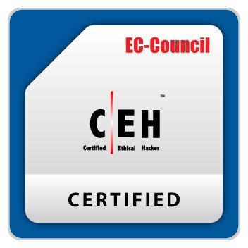
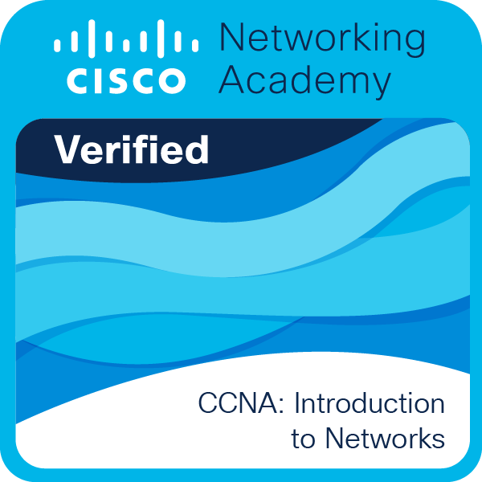
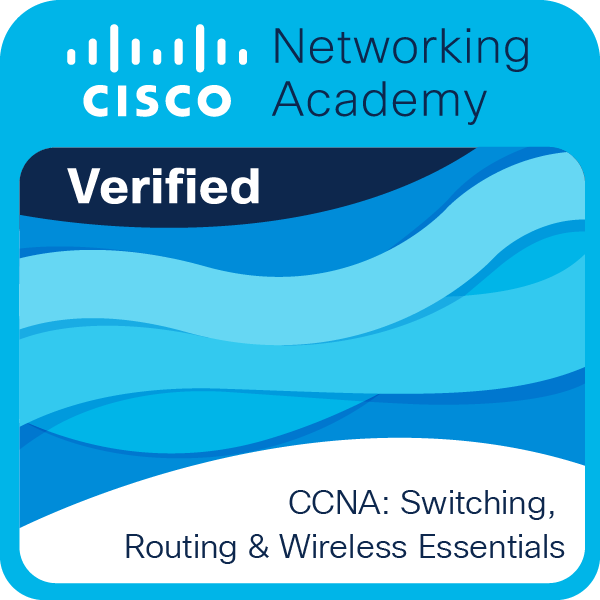

<!-- ========================= [ d4nnyX :: profile ] ========================= -->

```text
██████╗ ██╗  ██╗███╗   ██╗███╗   ██╗██╗   ██╗██╗  ██╗
██╔══██╗██║  ██║████╗  ██║████╗  ██║╚██╗ ██╔╝╚██╗██╔╝
██║  ██║███████║██╔██╗ ██║██╔██╗ ██║ ╚████╔╝  ╚███╔╝ 
██║  ██║╚════██║██║╚██╗██║██║╚██╗██║  ╚██╔╝   ██╔██╗ 
██████╔╝     ██║██║ ╚████║██║ ╚████║   ██║   ██╔╝ ██╗
╚═════╝      ╚═╝╚═╝  ╚═══╝╚═╝  ╚═══╝   ╚═╝   ╚═╝  ╚═╝
```

<p align="center">
  
</p>

<p align="center">
  
  
  
  
  
</p>

<p align="center">
  <a href="https://www.ahmdanial.online"></a>
  <a href="https://www.linkedin.com/in/ahmdanial/"></a>
</p>

---

### `root@d4nnyX:~# whoami`

```yaml
name:      Ahmad Danial (d4nnyX)
location:  Bangi, Selangor, Malaysia
role:      Security Engineer // Cloud Security // Pentester
education: BSc Computer Science (Cybersecurity) @ UNITEN
currently:
  - Pentesting web apps, networks & Active Directory (authorized targets only)
  - Hunting AWS misconfigurations and IAM attack paths
  - Implementing ISO/IEC 27001 controls (ISMS)
  - Building & breaking CTF challenges with CLICQ DIV:IDE
```

### `root@d4nnyX:~# nmap -sV d4nnyX`

```text
Starting Nmap ( https://nmap.org )
Nmap scan report for d4nnyX
Host is up (0.0013s latency).

PORT       STATE  SERVICE                 VERSION
22/tcp     open   linux-networking        TCP/IP, routing & switching, firewalls
443/tcp    open   web-app-security        Burp Suite, web exploitation
445/tcp    open   active-directory        CPTS-grade enumeration & attacks
8080/tcp   open   vuln-assessment         Nmap, Metasploit, Wireshark
9000/tcp   open   aws-cloud-security      Boto3, IAM, S3, CloudTrail
27001/tcp  open   iso-27001-compliance    ISMS, NIST CSF 2.0, CIS Benchmarks

Service detection performed. 1 operator up, 0 vulnerabilities disclosed ;)
```

---

### `root@d4nnyX:~# ls -la ~/arsenal`

| `drwx` | Loadout |
|---|---|
| **Offensive tools** |      |
| **Forensics & IR** |    |
| **Disciplines** |       |
| **Frameworks** |     |
| **Cloud & infra** |  |
| **Languages** |  |
| **Frameworks (dev)** |  |

---

### `root@d4nnyX:~# cat ./exploits/cloudsentry.md`

> **CloudSentry** — automated AWS misconfiguration & compliance assessment tool *(Final Year Project)*
>
> ```text
> [+] public S3 buckets           [+] over-permissive IAM roles
> [+] open inbound ports          [+] disabled CloudTrail logging
> [+] missing MFA                 [>] mapped to CIS / NIST CSF 2.0 / ISO 27001:2022
> ```
> `Python` `Boto3` `Flask` `React.js` `PostgreSQL` `Docker` `ReportLab`

---

### `root@d4nnyX:~# cat scoreboard.txt`

```text
  [ 3rd / 118 ]   BingoCTF                               @ APU
  [ Top 28 ]      International Game of Hackers (IGOH)   @ UNIKL   (120 teams)
  [ Top 30 ]      International Battle of Hackers (IBOH) @ APU     (145 teams)
  [ PLAYED ]      UM Cybersecurity Summit CTF 2025
  [ ORGANIZER ]   Program Director, CLICQ DIV:IDE CTF 2026
  [ AUTHOR ]      Web exploitation challenges, CLICQ DIV:IDE & PitchCraft CTF
```

---

### `root@d4nnyX:~# ls ~/certs`

<p align="center">
  
  &nbsp;
  
  &nbsp;
  <a href="https://www.credly.com/badges/55934546-5336-45b5-93b5-d667765a1281/public_url"></a>
  &nbsp;
  <a href="https://www.credly.com/badges/d40d4020-ee3f-4151-9b01-170a3416211b/public_url"></a>
  &nbsp;
  <a href="https://www.credly.com/badges/3a8a74b0-f501-4cc1-ac69-85dccf415358/public_url"></a>
</p>

<p align="center"><sub>+ zSecurity: Learn Ethical Hacking From Scratch 2024 · Website Hacking / Penetration Testing</sub></p>

---

### `root@d4nnyX:~# ./stats --verbose`

<p align="center">
  
  
</p>

---

```diff
- [!] Connection closed by d4nnyX. Stay curious. Stay authorized.
```
