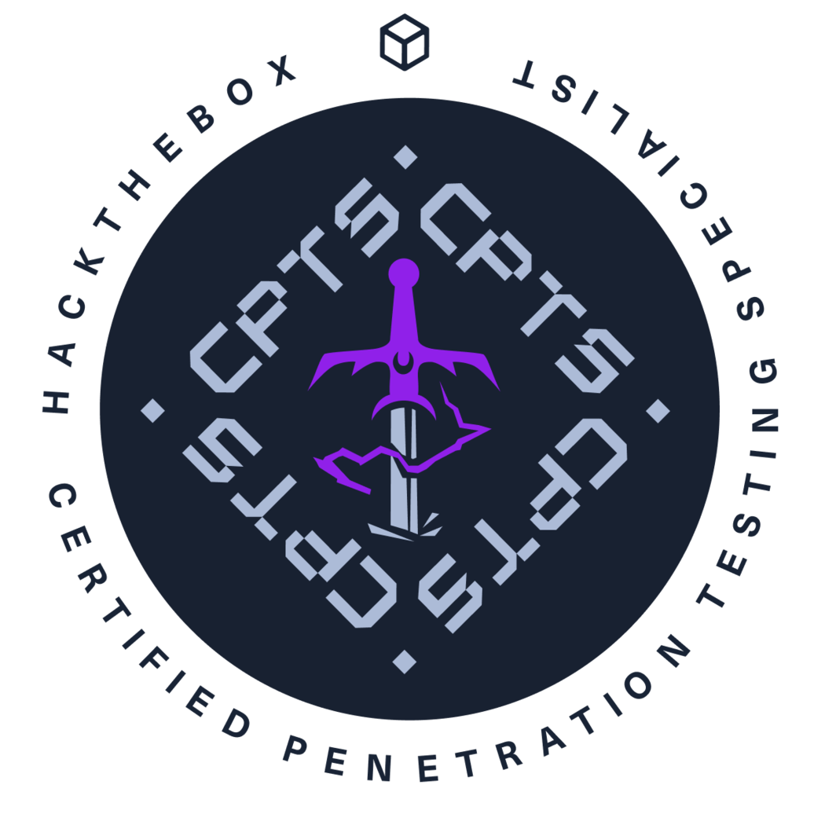
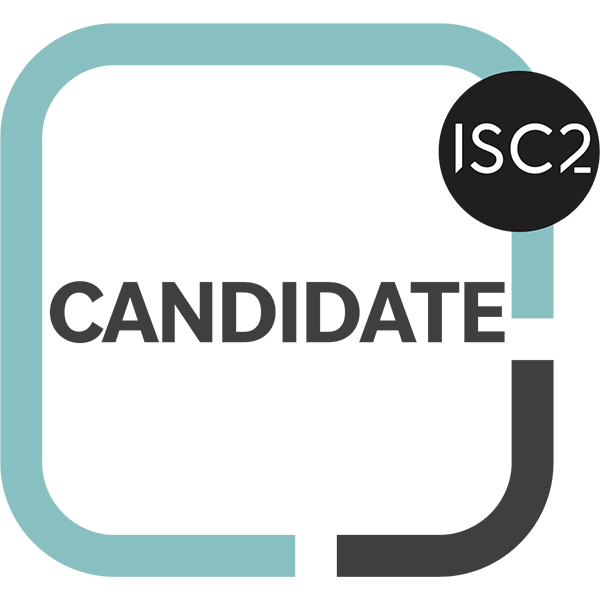

<!-- Header: animated terminal-style typing line -->
<p align="center">
  
</p>

<p align="center">
  
  
  
  
</p>

---

### `$ cat about.yaml`

```yaml
name:      d4nnyX
role:      Security Engineer
domain:    Cloud Security
focus:     Penetration Testing
mindset:   "Assume breach. Verify everything."
certs:     [HTB CPTS, CEH, ISC2 Candidate, CCNA ITN, CCNA SRWE]
currently:
  - Testing web apps, networks & Active Directory
  - Hunting misconfigs and IAM attack paths in the cloud
  - Automating recon and assessment workflows
```

---

### `$ ls ~/certs`

<p align="center">
  
  &nbsp;
  
  &nbsp;
  
  &nbsp;
  
  &nbsp;
  
</p>

---

### `$ ls ~/arsenal`

| Category | Tools |
|---|---|
| **Offensive** |  |
| **Cloud** |  |
| **Containers & DevOps** |  |

---

### `$ ./stats.sh`

<p align="center">
  
  
</p>

---

<p align="center"><code>exit 0</code> — thanks for stopping by.</p>
